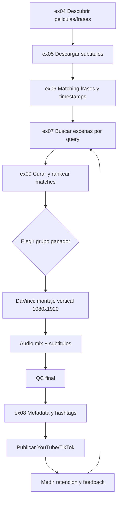

# Diagrama de flujo de edicion (Shorts)

## Lectura rapida

- ex09 es el filtro clave antes de editar: evita cortar material mediocre.
- ex08 se usa al final para publicar con contexto de tendencia.
- El loop vuelve a ex07 para mejorar la siguiente tanda.
