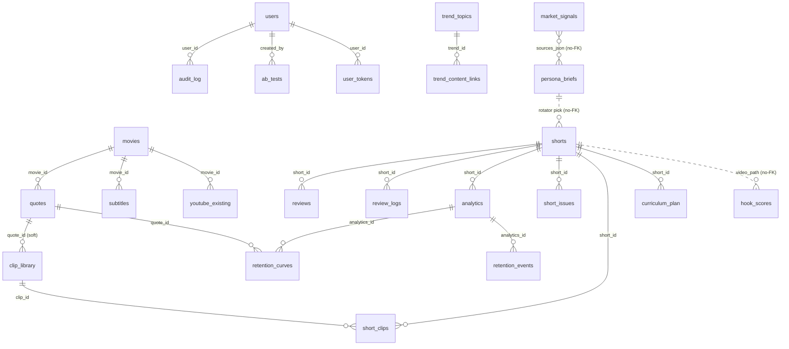

# Data Model · YouLikeIt

> Schema canónico de la base SQLite (`data/shorts_pipeline.db`). **Fuente de
> verdad: `src/core/db.py` (`SCHEMA`)**. Este doc lo explica; si divergen, gana
> `db.py`. ~40 tablas agrupadas por subsistema. Decisión de usar SQLite:
> [DECISIONS/0002](DECISIONS/0002-why-sqlite-not-postgres.md).

## Cómo leer este doc

- **Owner del schema:** quién puede cambiar la definición de la tabla (vía
  migración en `_migrate_columns` o edición de `SCHEMA`, coordinado con el QA Agent).
- **Lectores declarados:** módulos que leen la tabla. Consumidores no declarados
  son anti-patrón (ver MLOPS_FLOW § Undeclared consumers).
- **Ciclo de vida:** cuándo nace una fila y cuándo muere/expira.

Convenciones globales:
- Todo `*_at` / timestamp en **UTC ISO**.
- PK siempre `id INTEGER PRIMARY KEY AUTOINCREMENT`.
- Cambios de columna se hacen vía `_migrate_columns()` (ALTER idempotente), no editando filas existentes.

---

## ER diagram (relaciones FK)

> Nota: las relaciones `signals → briefs → shorts → hook_scores` son **lógicas,
> no FK físicas** (se cruzan por `sources_json`, slug y `video_path`). El flujo es
> intencionalmente unidireccional (MLOPS_FLOW § Pipeline jungles).

---

## Subsistema 1 · Flujo de información (signals → briefs)

Es el corazón del sistema actual. Owner: **Signals Agent**.

### market_signals

Señales crudas ingeridas por `market_signals.py`. Una fila por `(source, normalized_title)`.

| Invariante | Detalle |
|---|---|
| UNIQUE | `(source, normalized_title)` — re-promoción no duplica |
| `normalized_title` | lowercase, sin puntuación, espacios colapsados |
| `domain` ∈ | `gaming` \| `anime_manga` \| `movies_tv` \| `music` \| `latam` |
| `fetched_at` | UTC; índice `DESC` para ventana de retención |

- **Owner:** Signals Agent. **Lectores:** `signals_distiller.py`.
- **Ciclo de vida:** insert en cada refresh; **delete** por ventana de retención (N días) en el distiller.

### persona_briefs

Briefs destilados por persona. El distiller escribe; el rotator/script lee.

| Invariante | Detalle |
|---|---|
| UNIQUE | `(persona, cluster_key, created_at)` — sin duplicados por corrida |
| `persona` ∈ | `deep_mind` \| `pop_oracle` \| `latam` |
| `consumed_at IS NULL` | ⇒ disponible para el rotator |
| `sources_json` | JSON array de `market_signals.id` que formaron el cluster |

- **Owner:** Signals Agent. **Lectores:** `content_rotator.py`, `brief_resolver.py`.
- **Ciclo de vida:** insert por distill; `consumed_at` se setea cuando el rotator lo elige; expira con la ventana de retención.

### scraper_health

Bookkeeping de salud de cada scraper.

| Campo clave | Uso |
|---|---|
| `success_count` / `failure_count` | `fail_rate = failure/(success+failure)`; alerta > 0.3 |
| `last_success_at` / `last_error` | diagnóstico en [RUNBOOK Incident 1](../operations/RUNBOOK.md) |

- **Owner:** Signals Agent. **Lectores:** `briefs_dashboard.py` (panel SCRAPER HEALTH).
- **Ciclo de vida:** upsert por scraper en cada refresh.

---

## Subsistema 2 · Trends ETL (multi-tópico)

Capa de trends Google/RSS, previa a market_signals. Owner: **Signals Agent**.

| Tabla | Rol | Invariantes / notas |
|---|---|---|
| `trend_topics` | Trends multi-tópico (Google/RSS) | `embedding BLOB`, `sentiment`; índices por `topic`, `(cluster, snapshot_date)` |
| `topic_clusters` | Clusters configurables (seeds + RSS + intervalo) | `cluster_name` UNIQUE; sembrado con 14 clusters por defecto |
| `trend_content_links` | Cross-ref trend ↔ contenido | FK `trend_id → trend_topics`; `content_type`+`content_id` polimórfico |
| `trending_people` | Celebridades en tendencia | `tmdb_person_id` enlaza a TMDB; índice por `name`, `snapshot_date` |
| `trending_topics` | Snapshots diarios Google Trends (legacy/simple) | índice por `snapshot_date`, `topic` |
| `etl_runs` | Tracking de corridas ETL | `status` running/completed/failed; `topics_found/new/linked`, `errors` |

---

## Subsistema 3 · Contenido y catálogo (movies/quotes/clips)

Materia prima curada. Owner: **Production Agent**.

| Tabla | Rol | Invariantes / notas |
|---|---|---|
| `movies` | Catálogo de películas (TMDB) | `tmdb_id` UNIQUE; `insert_movie` dedupe por tmdb_id |
| `quotes` | Frases con timestamps + clasificación | FK `movie_id → movies`; campos de clasificación (ex10) + taxonomía de lección (ex31, vía migración) |
| `subtitles` | SRT por película | FK `movie_id → movies` |
| `clip_library` | Clips/paneles reutilizables (cross-vertical) | dedupe por `file_path` (`register_clip`); `chroma_id` enlaza a ChromaDB para búsqueda semántica |
| `youtube_existing` | Videos ya existentes en YT (referencia) | `video_id` UNIQUE; FK `movie_id → movies` |
| `url_cache` | Cache de URLs YouTube por película/quote | índice por `movie_title` |

---

## Subsistema 4 · Producción de shorts

`shorts` es el hub de producción. Owner: **Production Agent**.

### shorts

Fila por short producido (o en cola). Hub de FK entrante.

| Campo clave | Uso |
|---|---|
| `status` | `pending` \| `rendered` \| `uploaded` |
| `quote_ids` | JSON array de quotes usadas |
| `series_name` / `arc_name` / `part_number` | rotación por serie |
| `narration_*` | guion algorítmico (intro/outro/segments JSON) |

- **Owner:** Production Agent. **Lectores:** uploader, hook scorer (vía `video_path`), dashboard.
- **Ciclo de vida:** insert al planear; `status` avanza pending→rendered→uploaded.

| Tabla satélite | Rol | FK |
|---|---|---|
| `short_clips` | Junction short ↔ clips (orden + tiempos) | `short_id → shorts`, `clip_id → clip_library` |
| `short_issues` | Defectos reportados por frame/rango | `short_id → shorts`; `resolved` flag |
| `reviews` | Revisión humana/agente del short | `short_id → shorts`; `status`, `rating` |
| `review_logs` | Bitácora de acciones sobre un short | `short_id → shorts`; `action` |
| `pipeline_runs` | Corridas automáticas del pipeline | `pipeline` manga/movies/learn; `status`; `trigger` |
| `curriculum_plan` | Plan editorial (qué producir y por qué) | `short_id → shorts`; `status` planned→completed |

---

## Subsistema 5 · Hook quality gate

### hook_scores

Scores del gate post-render. Owner: **Scoring Agent**. (Schema duplicado en
`apps.scoring.hook_scorer.SCHEMA_HOOK_SCORES` para uso standalone del módulo.)

| Campo clave | Uso |
|---|---|
| `overall_score` / `passed` | gate; hoy `block_on_fail=False` (ver [ADR 0001](DECISIONS/0001-why-algorithmic-not-llm.md)) |
| `audio_energy_score`, `cps_score`, `accent_word_score`, `llm_score` | sub-scores |
| `video_path` | enlace lógico a `shorts` (no FK); índice |

- **Lectores:** `score_hooks.py`, dashboard. **Ciclo:** insert por scoreo; `--rescore` regenera.

---

## Subsistema 6 · Analítica e insights

Owner: **Analytics Agent** (Plausible) + análisis de retención (Production/QA).

| Tabla | Rol | Invariantes / notas |
|---|---|---|
| `analytics` | Métricas por short × plataforma | FK `short_id → shorts`; `retention_3s` = efectividad del hook; columnas extra vía migración (ex24) |
| `retention_curves` | Curva de retención por segundo | FK `analytics_id`, `quote_id` |
| `retention_events` | Eventos (cliff/plateau/recovery/hook_pass) | FK `analytics_id`; `content_at_event` JSON |
| `audience_demographics` | Demografía por snapshot | `dimension` age/gender/country |
| `audience_segments` | Segmentos DBSCAN (ex26) | guarda `eps_used`, `min_samples_used` |
| `competitor_videos` | Videos de competencia analizados | `platform_video_id` UNIQUE; `what_works` JSON |
| `model_snapshots` | Snapshots de modelos (RF/DBSCAN/LinReg) | `feature_importances`, `r_squared_cv` |
| `plausible_cache` | Cache 1h de Stats API | UNIQUE `(endpoint, params_hash)`; **sin PII** |
| `plausible_pageviews` | Tráfico por página/periodo | UNIQUE `(page, period_start, period_end)` |
| `plausible_events` | Goal events (persona_click, cta_click…) | UNIQUE `(event_name, page, period_start, period_end)`; **sin PII en raw_props** |

> Privacidad (Plausible): no se persisten IPs, user agents ni PII (GDPR end-to-end).
> Ver [ANALYTICS_AGENT.md](../agents/ANALYTICS_AGENT.md) y [SECURITY.md](../operations/SECURITY.md).

---

## Subsistema 7 · A/B testing, aprendizaje y control

Owner: **Scoring Agent** (A/B) + sistema.

| Tabla | Rol | Invariantes / notas |
|---|---|---|
| `ab_tests` | Experimentos A/B | `status` running/completed/cancelled; `winner` a/b/inconclusive; `p_value`, `effect_size`; FK `created_by → users` |
| `goals` | Metas por métrica con proyección | `status` active/achieved/missed/revised; `trend_slope` |
| `knowledge_base` | Insights aprendidos | `confidence` 0-1; `times_validated` vs `times_contradicted`; `is_active` |
| `learning_log` | Bitácora de ajustes por ciclo | `old_value`→`new_value` + `reason` |
| `users` | Usuarios y agentes | `username` UNIQUE; sembrado: admin + 3 agentes claude:* |
| `user_tokens` | Tokens de API (ex29) | `token` UNIQUE; FK `user_id → users`; `expires_at` |
| `audit_log` | Auditoría de acciones | FK `user_id → users`; `entity_type`+`entity_id`; `old_value`/`new_value` JSON |

---

## Invariantes a verificar en tests

- ALIAS_MAP sin huérfanos contra el CATALOG (smoke 1, [INTEGRATION_CHECKLIST](../testing/INTEGRATION_CHECKLIST.md)).
- `market_signals (source, normalized_title)` UNIQUE — `TestPersistence`.
- `persona_briefs` cada persona ≥1 — `TestBriefsPerPersona`.
- `hook_scores` schema idempotente; video faltante → score 0 — `TestScoreHookRobustness`.

---

## Pendiente / deuda

- Validación de enums (`domain`, `persona`) hoy en `signals_validation.py`; migrar
  a Pandera cuando se escale a DataFrames.
- `embedding BLOB` en `trend_topics` y `chroma_id` en `clip_library` apuntan a la
  futura capa de embeddings (dedupe capa 3) — ver MLOPS_FLOW § Roadmap.
