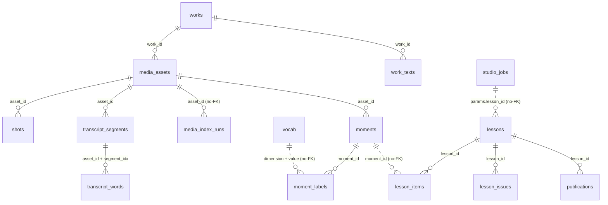
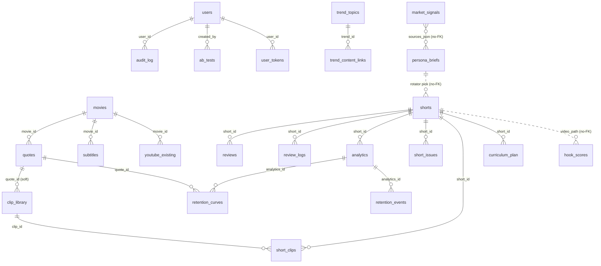

# Data Model · YouLikeIt

> Schema canónico de la base SQLite (`data/shorts_pipeline.db`). **Fuente de
> verdad: `src/core/db.py` (`SCHEMA`) y los `schema.py` de cada dominio** que
> `get_db` crea vía `_DOMAIN_SCHEMA_ENSURERS` (`apps/media`, `apps/moments`,
> `apps/supercut`, `apps/studio`, entre otros). Este doc lo explica; si divergen,
> gana el código. Decisión de usar SQLite:
> [DECISIONS/0002](DECISIONS/0002-why-sqlite-not-postgres.md).
>
> El sitio público `web/` tiene **otra** base, `web.db` (ver § web.db al final).
> Última revisión: 2026-11-04.

## Cómo leer este doc

- **Owner del schema:** quién puede cambiar la definición de la tabla (vía
  migración en `_migrate_columns` o edición de `SCHEMA`, coordinado con el QA Agent).
- **Lectores declarados:** módulos que leen la tabla. Consumidores no declarados
  son anti-patrón (ver MLOPS_FLOW § Undeclared consumers).
- **Ciclo de vida:** cuándo nace una fila y cuándo muere/expira.

Convenciones globales:
- Todo `*_at` / timestamp en **UTC**. Las tablas del estudio (`lessons`, `lesson_issues`,
  `publications`, `studio_jobs`) guardan texto ISO-8601 con `Z`; las de media/moments usan
  `CURRENT_TIMESTAMP` de SQLite.
- PK `id INTEGER PRIMARY KEY AUTOINCREMENT`, salvo tablas hijas con PK compuesta (`shots`,
  `transcript_*`, `lesson_items`, `moment_labels`, `vocab`, `work_texts`).
- Cambios de columna se hacen vía `_migrate_columns()` (ALTER idempotente), no editando filas existentes.
- Conexión: `core.db.get_db(DATA_DIR)` activa `journal_mode=WAL` y `busy_timeout=5000` (API, jobs en
  hilos y CLI escriben a la vez). Una conexión por request o hilo.

---

## Producto actual · ETL de lecciones

Owners: Media Agent (`works` → `media_index_runs`), Moments Agent (`vocab` → `moment_labels`),
supercut/studio (`lessons` → `studio_jobs`). Arquitectura: [SUPERCUT_ETL.md](SUPERCUT_ETL.md).

### Media (`src/apps/media/schema.py`)

| Tabla | Columnas | Invariantes / notas |
|---|---|---|
| `works` | `id`, `kind` (`movie`\|`series`), `title`, `year`, `tmdb_id`, `imdb_id`, `lang`, `created_at` | UNIQUE `(kind, title, year)`; `upsert_work` busca con `COLLATE NOCASE` y `year IS ?` (los NULL no chocan en UNIQUE) |
| `media_assets` | `id`, `work_id`, `season`, `episode`, `provider` (`archive_org`\|`local`\|`jellyfin`), `external_id`, `master_uri`, `proxy_uri`, `proxy_path`, `audio_path`, `duration_ms`, `width`, `height`, `fps`, `size_bytes`, `rights`, `license_url`, `accept_ranges`, `extra_json`, `transcribed_at`, `shots_at`, `created_at` | UNIQUE `(provider, external_id, master_uri)`; `rights` default `unknown`; solo `public_domain`/`open_license`/`owned` son usables. Indexado = `transcribed_at` y `shots_at` no nulos |
| `shots` | `asset_id`, `idx`, `start_ms`, `end_ms`, `detector` | PK `(asset_id, idx)`; se reemplazan completos al re-detectar |
| `transcript_segments` | `asset_id`, `idx`, `start_ms`, `end_ms`, `text`, `lang`, `avg_logprob`, `no_speech_prob` | PK `(asset_id, idx)` |
| `transcript_words` | `asset_id`, `segment_idx`, `idx`, `start_ms`, `end_ms`, `word`, `prob` | PK `(asset_id, segment_idx, idx)`; índice `(asset_id, start_ms)` |
| `media_index_runs` | `id`, `asset_id`, `step` (`probe`\|`proxy`\|`audio`\|`shots`\|`asr`…), `status` (`ok`\|`error`\|`skipped`), `seconds`, `detail_json`, `finished_at` | Solo inserta (observabilidad del ETL); lo lee `ylk media runs` |

### Moments (`src/apps/moments/schema.py`)

| Tabla | Columnas | Invariantes / notas |
|---|---|---|
| `vocab` | `dimension`, `value`, `label_es`, `label_en`, `desc_es`, `desc_en` | PK `(dimension, value)`; copia de `data/vocab/` para joins |
| `work_texts` | `work_id`, `kind` (`wikiquote`\|`plot`), `lang`, `source_url`, `items_json`, `fetched_at` | PK `(work_id, kind, lang)`; caché de fuentes externas; un resultado vacío vence a los 7 días |
| `moments` | `id`, `asset_id`, `start_ms`, `end_ms`, `shot_in`, `shot_out`, `text`, `position` (0–1), `importance`, `signal_score`, `features_json`, `anchors_json`, `summary_es`, `status` (`candidate`\|`labeled`\|`rejected`), `labeled_by`, `created_at` | UNIQUE `(asset_id, start_ms, end_ms)`; re-detectar reemplaza solo los `candidate` (los etiquetados se conservan) |
| `moment_labels` | `moment_id`, `dimension` (`trope`\|`beat`\|`emotion`\|`role`\|`theme`), `value`, `confidence`, `source` (`llm:<proveedor>`\|`lexical`\|`position`\|`quote`\|`manual`) | PK `(moment_id, dimension, value, source)`; índice `(dimension, value, confidence DESC)` para `find_moments`. Las manuales tienen `confidence = 1.0` |

### Lecciones y estudio (`src/apps/supercut/schema.py`, `src/apps/studio/schema.py`)

| Tabla | Columnas | Invariantes / notas |
|---|---|---|
| `lessons` | `id`, `title`, `spec` (`dimension:valor`), `format` (`essay`), `lang`, `status`, `script_json`, `script_source` (`llm:<proveedor>`\|`template`\|`manual`), `output_path`, `duration_s`, `reject_reason`, `created_at`, `updated_at` | `status` ∈ `draft`, `rendering`, `rendered`, `approved`, `rejected`, `published` (máquina de estados en [SUPERCUT_ETL.md](SUPERCUT_ETL.md)) |
| `lesson_items` | `lesson_id`, `idx`, `moment_id`, `in_ms`, `out_ms`, `caption` | PK `(lesson_id, idx)`; es la **receta** del Short. Cada tramo ≤ 60 s y de un asset con derechos usables |
| `lesson_issues` | `id`, `lesson_id`, `issue_type` (`voice`\|`caption`\|`timing`\|`image`\|`rights`\|`other`), `start_s`, `end_s`, `note`, `created_at` | `end_s ≥ start_s ≥ 0` |
| `publications` | `id`, `lesson_id`, `platform` (`tiktok`\|`youtube`), `status` (`pending`\|`sent`\|`published`\|`failed`), `external_id` (publish_id o video_id), `url`, `detail`, `created_at`, `updated_at` | TikTok termina en `sent`, YouTube en `published` |
| `studio_jobs` | `id`, `type` (`index`\|`detect`\|`label`\|`render`\|`publish_tiktok`\|`publish_youtube`), `status` (`queued`\|`running`\|`done`\|`error`), `params_json`, `progress_json`, `result_json`, `error`, `created_at`, `started_at`, `finished_at` | Índice `(status, id)`; un worker; al arrancar, `running` → `error` |

### `cross_references` (`src/core/db.py`)

Referencias culturales entre obras para las personas (producto anterior; sembrada por
`scripts/setup/seed_cross_refs.py`). Columnas: `id`, `source_work`, `source_type`, `target_work`,
`target_type`, `target_creator`, `reference_type`, `description_deep_mind`, `description_cinephile`,
`description_pop_oracle`, `themes`, `strength` (default 0.7), `created_at`. Índices por `source_work`
y `target_work`. Las lecciones no la usan.

---

## Producto anterior · ER diagram (relaciones FK)

> Tablas del producto de shorts por persona (señales, producción, scoring, analítica). Siguen en el
> esquema y con tests, pero las lecciones no las usan.

> Nota: las relaciones `signals → briefs → shorts → hook_scores` son **lógicas,
> no FK físicas** (se cruzan por `sources_json`, slug y `video_path`). El flujo es
> intencionalmente unidireccional (MLOPS_FLOW § Pipeline jungles).

---

## Subsistema 1 · Flujo de información (signals → briefs)

Es el corazón del sistema actual. Owner: **Signals Agent**.

### market_signals

Señales crudas ingeridas por `market_signals.py`. Una fila por `(source, normalized_title)`.

| Invariante | Detalle |
|---|---|
| UNIQUE | `(source, normalized_title)` — re-promoción no duplica |
| `normalized_title` | lowercase, sin puntuación, espacios colapsados |
| `domain` ∈ | `gaming` \| `anime_manga` \| `movies_tv` \| `music` \| `latam` |
| `fetched_at` | UTC; índice `DESC` para ventana de retención |

- **Owner:** Signals Agent. **Lectores:** `signals_distiller.py`.
- **Ciclo de vida:** insert en cada refresh; **delete** por ventana de retención (N días) en el distiller.

### persona_briefs

Briefs destilados por persona. El distiller escribe; el rotator/script lee.

| Invariante | Detalle |
|---|---|
| UNIQUE | `(persona, cluster_key, created_at)` — sin duplicados por corrida |
| `persona` ∈ | `deep_mind` \| `pop_oracle` \| `latam` |
| `consumed_at IS NULL` | ⇒ disponible para el rotator |
| `sources_json` | JSON array de `market_signals.id` que formaron el cluster |

- **Owner:** Signals Agent. **Lectores:** `content_rotator.py`, `brief_resolver.py`.
- **Ciclo de vida:** insert por distill; `consumed_at` se setea cuando el rotator lo elige; expira con la ventana de retención.

### scraper_health

Bookkeeping de salud de cada scraper.

| Campo clave | Uso |
|---|---|
| `success_count` / `failure_count` | `fail_rate = failure/(success+failure)`; alerta > 0.3 |
| `last_success_at` / `last_error` | diagnóstico en [RUNBOOK Incident 1](../operations/RUNBOOK.md) |

- **Owner:** Signals Agent. **Lectores:** `briefs_dashboard.py` (panel SCRAPER HEALTH).
- **Ciclo de vida:** upsert por scraper en cada refresh.

---

## Subsistema 2 · Trends ETL (multi-tópico)

Capa de trends Google/RSS, previa a market_signals. Owner: **Signals Agent**.

| Tabla | Rol | Invariantes / notas |
|---|---|---|
| `trend_topics` | Trends multi-tópico (Google/RSS) | `embedding BLOB`, `sentiment`; índices por `topic`, `(cluster, snapshot_date)` |
| `topic_clusters` | Clusters configurables (seeds + RSS + intervalo) | `cluster_name` UNIQUE; sembrado con 14 clusters por defecto |
| `trend_content_links` | Cross-ref trend ↔ contenido | FK `trend_id → trend_topics`; `content_type`+`content_id` polimórfico |
| `trending_people` | Celebridades en tendencia | `tmdb_person_id` enlaza a TMDB; índice por `name`, `snapshot_date` |
| `trending_topics` | Snapshots diarios Google Trends (legacy/simple) | índice por `snapshot_date`, `topic` |
| `etl_runs` | Tracking de corridas ETL | `status` running/completed/failed; `topics_found/new/linked`, `errors` |

---

## Subsistema 3 · Contenido y catálogo (movies/quotes/clips)

Materia prima curada. Owner: **Production Agent**.

| Tabla | Rol | Invariantes / notas |
|---|---|---|
| `movies` | Catálogo de películas (TMDB) | `tmdb_id` UNIQUE; `insert_movie` dedupe por tmdb_id |
| `quotes` | Frases con timestamps + clasificación | FK `movie_id → movies`; campos de clasificación (ex10) + taxonomía de lección (ex31, vía migración) |
| `subtitles` | SRT por película | FK `movie_id → movies` |
| `clip_library` | Clips/paneles reutilizables (cross-vertical) | dedupe por `file_path` (`register_clip`); `chroma_id` enlaza a ChromaDB para búsqueda semántica |
| `youtube_existing` | Videos ya existentes en YT (referencia) | `video_id` UNIQUE; FK `movie_id → movies` |
| `url_cache` | Cache de URLs YouTube por película/quote | índice por `movie_title` |

---

## Subsistema 4 · Producción de shorts

`shorts` es el hub de producción. Owner: **Production Agent**.

### shorts

Fila por short producido (o en cola). Hub de FK entrante.

| Campo clave | Uso |
|---|---|
| `status` | `pending` \| `rendered` \| `uploaded` |
| `quote_ids` | JSON array de quotes usadas |
| `series_name` / `arc_name` / `part_number` | rotación por serie |
| `narration_*` | guion algorítmico (intro/outro/segments JSON) |

- **Owner:** Production Agent. **Lectores:** uploader, hook scorer (vía `video_path`), dashboard.
- **Ciclo de vida:** insert al planear; `status` avanza pending→rendered→uploaded.

| Tabla satélite | Rol | FK |
|---|---|---|
| `short_clips` | Junction short ↔ clips (orden + tiempos) | `short_id → shorts`, `clip_id → clip_library` |
| `short_issues` | Defectos reportados por frame/rango | `short_id → shorts`; `resolved` flag |
| `reviews` | Revisión humana/agente del short | `short_id → shorts`; `status`, `rating` |
| `review_logs` | Bitácora de acciones sobre un short | `short_id → shorts`; `action` |
| `pipeline_runs` | Corridas automáticas del pipeline | `pipeline` manga/movies/learn; `status`; `trigger` |
| `curriculum_plan` | Plan editorial (qué producir y por qué) | `short_id → shorts`; `status` planned→completed |

---

## Subsistema 5 · Hook quality gate

### hook_scores

Scores del gate post-render. Owner: **Scoring Agent**. (Schema duplicado en
`apps.scoring.hook_scorer.SCHEMA_HOOK_SCORES` para uso standalone del módulo.)

| Campo clave | Uso |
|---|---|
| `overall_score` / `passed` | gate; hoy `block_on_fail=False` (ver [ADR 0001](DECISIONS/0001-why-algorithmic-not-llm.md)) |
| `audio_energy_score`, `cps_score`, `accent_word_score`, `llm_score` | sub-scores |
| `video_path` | enlace lógico a `shorts` (no FK); índice |

- **Lectores:** `score_hooks.py`, dashboard. **Ciclo:** insert por scoreo; `--rescore` regenera.

---

## Subsistema 6 · Analítica e insights

Owner: **Analytics Agent** (Plausible) + análisis de retención (Production/QA).

| Tabla | Rol | Invariantes / notas |
|---|---|---|
| `analytics` | Métricas por short × plataforma | FK `short_id → shorts`; `retention_3s` = efectividad del hook; columnas extra vía migración (ex24) |
| `retention_curves` | Curva de retención por segundo | FK `analytics_id`, `quote_id` |
| `retention_events` | Eventos (cliff/plateau/recovery/hook_pass) | FK `analytics_id`; `content_at_event` JSON |
| `audience_demographics` | Demografía por snapshot | `dimension` age/gender/country |
| `audience_segments` | Segmentos DBSCAN (ex26) | guarda `eps_used`, `min_samples_used` |
| `competitor_videos` | Videos de competencia analizados | `platform_video_id` UNIQUE; `what_works` JSON |
| `model_snapshots` | Snapshots de modelos (RF/DBSCAN/LinReg) | `feature_importances`, `r_squared_cv` |
| `plausible_cache` | Cache 1h de Stats API | UNIQUE `(endpoint, params_hash)`; **sin PII** |
| `plausible_pageviews` | Tráfico por página/periodo | UNIQUE `(page, period_start, period_end)` |
| `plausible_events` | Goal events (persona_click, cta_click…) | UNIQUE `(event_name, page, period_start, period_end)`; **sin PII en raw_props** |

> Privacidad (Plausible): no se persisten IPs, user agents ni PII (GDPR end-to-end).
> Ver [ANALYTICS_AGENT.md](../agents/ANALYTICS_AGENT.md) y [SECURITY.md](../operations/SECURITY.md).

---

## Subsistema 7 · A/B testing, aprendizaje y control

Owner: **Scoring Agent** (A/B) + sistema.

| Tabla | Rol | Invariantes / notas |
|---|---|---|
| `ab_tests` | Experimentos A/B | `status` running/completed/cancelled; `winner` a/b/inconclusive; `p_value`, `effect_size`; FK `created_by → users` |
| `goals` | Metas por métrica con proyección | `status` active/achieved/missed/revised; `trend_slope` |
| `knowledge_base` | Insights aprendidos | `confidence` 0-1; `times_validated` vs `times_contradicted`; `is_active` |
| `learning_log` | Bitácora de ajustes por ciclo | `old_value`→`new_value` + `reason` |
| `users` | Usuarios y agentes | `username` UNIQUE; sembrado: admin + 3 agentes claude:* |
| `user_tokens` | Tokens de API (ex29) | `token` UNIQUE; FK `user_id → users`; `expires_at` |
| `audit_log` | Auditoría de acciones | FK `user_id → users`; `entity_type`+`entity_id`; `old_value`/`new_value` JSON |

---

## Invariantes a verificar en tests

- ALIAS_MAP sin huérfanos contra el CATALOG (smoke 1, [INTEGRATION_CHECKLIST](../testing/INTEGRATION_CHECKLIST.md)).
- `market_signals (source, normalized_title)` UNIQUE — `TestPersistence`.
- `persona_briefs` cada persona ≥1 — `TestBriefsPerPersona`.
- `hook_scores` schema idempotente; video faltante → score 0 — `TestScoreHookRobustness`.

---

## Pendiente / deuda

- Validación de enums (`domain`, `persona`) hoy en `signals_validation.py`; migrar
  a Pandera cuando se escale a DataFrames.
- `embedding BLOB` en `trend_topics` y `chroma_id` en `clip_library` apuntan a la
  futura capa de embeddings (dedupe capa 3) — ver MLOPS_FLOW § Roadmap.
- `lesson_items.moment_id` y `moment_labels.value` no tienen FK física: borrar un momento o un valor
  del vocabulario deja referencias colgando (hoy no se borran).
- `user_tokens` y `users` eran de la API ex29 (retirada); quedan en el esquema sin uso activo.

---

## web.db (sitio público `web/`, Railway)

SQLite propia del sitio en `DATA_DIR/web.db` (volumen `/data`). Esquema en `web/app/store.py`.
Owner: dominio web. No comparte nada con `shorts_pipeline.db`.

| Tabla | Columnas | Invariantes / notas |
|---|---|---|
| `tiktok_accounts` | `open_id` (PK), `display_name`, `access_token_enc`, `refresh_token_enc`, `scope`, `expires_at`, `refresh_expires_at`, `updated_at` | Tokens cifrados con Fernet (`TOKEN_ENC_KEY`); no se guarda avatar. Desconectar borra la fila |
| `publishes` | `publish_id` (PK), `open_id`, `lesson_id`, `status`, `created_at` | `lesson_id` es el id de la lección del sitio o el `lesson_ref` del estudio (`lesson-<id>`); `status` es el de TikTok (`PROCESSING_UPLOAD`, `SEND_TO_USER_INBOX`…). Se borran al desconectar la cuenta |

Fechas en epoch (segundos, `INTEGER`).
