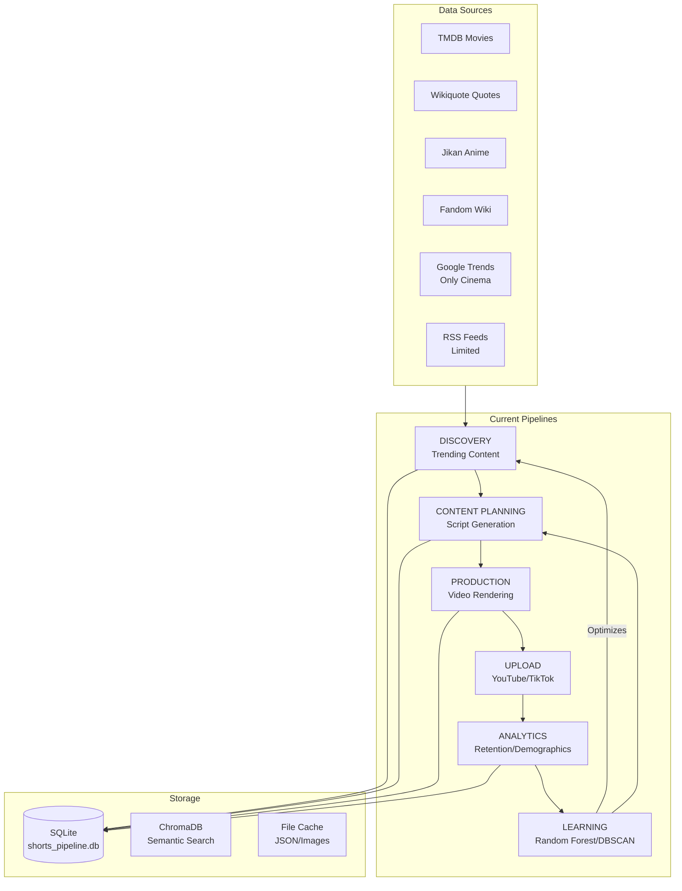
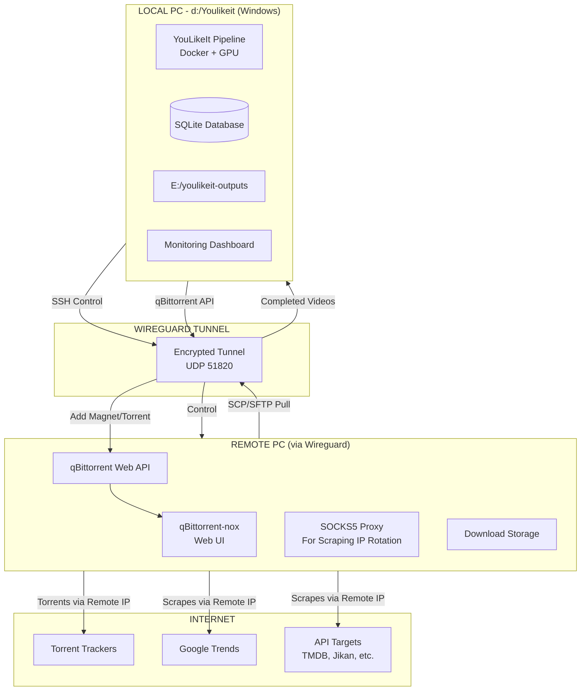

# YouLikeIt — Full Architecture Analysis + Multi-Topic Trends ETL (Google Trends Only) + Multi-PC Plan

## Table of Contents
1. [Project Comprehensive Analysis](#1-project-comprehensive-analysis)
2. [Existing Scraper Inventory](#2-existing-scraper-inventory)
3. [Multi-Topic Google Trends ETL Architecture](#3-multi-topic-google-trends-etl-architecture)
4. [Topic Diversity Expansion - 12 Clusters](#4-topic-diversity-expansion---12-clusters)
5. [Tendency Correlation Engine](#5-tendency-correlation-engine)
6. [Wireguard Multi-PC Infrastructure](#6-wireguard-multi-pc-infrastructure)
7. [Scraper Infrastructure Improvements](#7-scraper-infrastructure-improvements)
8. [Implementation Roadmap](#8-implementation-roadmap)
9. [Database Schema Additions](#9-database-schema-additions)
10. [Files to Create & Modify](#10-files-to-create--modify)

---

## 1. Project Comprehensive Analysis

### 1.1 What YouLikeIt Is

YouLikeIt is a **fully automated YouTube Shorts content factory** focused on extracting life lessons from movies, manga, anime, and pop culture. It has:

- **3 Personas**: Deep Mind (philosophical), Cinephile (energetic), Pop Oracle (dynamic female)
- **40 exercises** (ex00-ex40) organized in 6+ phases
- **6 pipelines**: Discovery → Planning → Production → Upload → Analytics → Learning
- **Docker infrastructure** with GPU (RTX 5060) acceleration
- **Multiple data sources**: TMDB, Jikan, AniList, MangaDex, Fandom Wiki, Google Trends, RSS feeds
- **LLM cascade**: Gemini Flash → Groq → Heuristic fallback
- **TTS**: Fish Speech S1-Mini with voice cloning
- **Analytics**: Random Forest, DBSCAN, ANOVA — all implemented from scratch

### 1.2 Current Architecture Diagram



### 1.3 Current Trend Infrastructure — What Exists Today

| Component | File | Scope | Limitation |
|-----------|------|-------|------------|
| Google Trends | `src/common/trends.py` | Cinema only (3 hardcoded seeds) | Only 2 queries per run, 6h cache, cinema-topics only |
| Culture Feed | `src/common/culture_feed.py` | Pop culture + RSS + NewsAPI | Doesn't capture real-time trends broadly |
| Trend Graph | `src/exercises/ex13_trend_graph.py` | NetworkX graph of songs/hashtags/themes | Post-hoc analysis, not ETL |
| LatAm Discovery | `src/common/latam_discovery.py` | Latin American TV/movies | Regional, not global trends |
| Trends Cache | `data/processed/trends_cache.json` | 5 cached cinema topics | Minimal data stored |

**Critical Gap**: The trends are only cinema-focused. No multi-topic coverage (news, tech, sports, gaming, memes, etc.). No cross-media correlation engine.

---

## 2. Existing Scraper Inventory

### 2.1 Current Scrapers

| Scraper | File | Method | Rate Limit | Data Volume |
|---------|------|--------|------------|-------------|
| TMDB Movies | `ex04_discover_movies.py` | REST API | ~1 req/s | ~50 movies/run |
| Wikiquote | `ex04_discover_movies.py` | Scraping | Unlim. | ~20 quotes/movie |
| Jikan (MAL) | `trending_anime.py` | REST API | 3 req/s | ~25 anime/run |
| AniList | `trending_anime.py` | GraphQL | Unlimited | ~50 entries |
| MangaDex | `mangadex.py` | REST API | 5 req/s | ~20 manga/run |
| Fandom Wiki | `fandom_scraper.py` | MediaWiki API | 1 req/s | ~10 images/run |
| Google Trends | `trends.py` | PyTrends | ~1 req/60s | ~15 topics/run |
| RSS News | `culture_feed.py` | HTTP polling | Unlim. | ~25 headlines |
| NewsAPI | `culture_feed.py` | REST API | 100 req/day | ~10 articles |
| TikTok Creative | `ex08_growth_pack.py` | Scraping | Variable | ~20 songs |
| SubDivX | `subdivx_client.py` | REST API | 20/day | ~5 subtitles |
| OpenSubtitles | `local_transcriber.py` | REST API | 20/day | ~5 subtitles |

### 2.2 Scraper Issues to Address

1. **No unified scraper framework** — each scraper has its own error handling, retry, caching
2. **No proxy/rotation** — all scrapers use local IP, risking blocks on rate-limited services
3. **No IP failover** — cannot route through Wireguard PC for blocked services
4. **No webhook/streaming** — all polls, no push notifications
5. **Google Trends seeds are hardcoded** — only 3 cinema seeds, no configurability

---

## 3. Multi-Topic Google Trends ETL Architecture

### 3.1 High-Level Architecture


### 3.2 What Changes in trends.py

The current `src/common/trends.py` has:

```python
seeds = ["películas", "movie quotes", "escenas de cine"]  # Only 3, all cinema
```

It will be upgraded to:

```python
# No hardcoded seeds — reads from topic_clusters table
def get_trends_for_cluster(cluster_name: str, geo: str = "") -> list[dict]:
    """Get trends for a specific topic cluster using its configured seeds."""
    cluster = get_cluster_config(cluster_name)
    all_topics = []
    for seed in cluster.seeds:
        topics = _query_pytrends(seed, geo=geo)
        all_topics.extend(topics)
        time.sleep(2)  # Rate limit
    return deduplicate(all_topics)
```

### 3.3 Topic Cluster Scheduler

The scheduler runs in a loop:

1. Every N minutes (configurable per cluster), pick the next cluster
2. Run its seed queries through PyTrends
3. Store results with cluster name, geo, timestamp
4. Generate embeddings for new topics
5. Cross-reference with content DB

**Priority-based scheduling:**
- High-priority clusters (Movies/TV, Anime/Manga, Music) run every 60-120 min
- Medium-priority (News, Tech, Sports, Gaming, Memes) run every 120-240 min  
- Low-priority (Fashion, Business, Science) run every 360 min

---

## 4. Topic Diversity Expansion - 12 Clusters

### 4.1 The 12 Topic Clusters

```python
TOPIC_CLUSTERS = {
    "movies_tv": {
        "display_name": "Movies & TV",
        "priority": 9,
        "seeds": [
            "movie release", "tv series", "streaming", "netflix", "disney+",
            "películas", "movie quotes", "escenas de cine",  # Keep existing
        ],
        "interval_minutes": 60,
        "rss_feeds": ["variety", "deadline", "screenrant"],
    },
    "anime_manga_otaku": {
        "display_name": "Anime & Manga",
        "priority": 9,
        "seeds": [
            "anime release", "manga chapter", "cosplay", "anime convention",
            "anime trending", "manga release",  # Keep existing culture_feed seeds
        ],
        "interval_minutes": 60,
        "rss_feeds": ["animenewsnetwork", "cbr"],
    },
    "music_entertainment": {
        "display_name": "Music & Entertainment",
        "priority": 8,
        "seeds": [
            "music charts", "new album", "concert", "festival",
            "billboard", "trending song", "viral music",
        ],
        "interval_minutes": 120,
        "rss_feeds": [],
    },
    "news_politics": {
        "display_name": "News & Politics",
        "priority": 8,
        "seeds": [
            "breaking news", "politics today", "world news",
            "trending news", "current events",
        ],
        "interval_minutes": 60,
        "rss_feeds": [],
    },
    "technology": {
        "display_name": "Technology",
        "priority": 7,
        "seeds": [
            "tech news", "AI", "startup", "gadgets",
            "cybersecurity", "new technology",
        ],
        "interval_minutes": 120,
        "rss_feeds": [],
    },
    "sports": {
        "display_name": "Sports",
        "priority": 6,
        "seeds": [
            "sports highlights", "football", "NBA", "UFC",
            "motorsport", "soccer", "sports news",
        ],
        "interval_minutes": 180,
        "rss_feeds": [],
    },
    "gaming": {
        "display_name": "Gaming",
        "priority": 5,
        "seeds": [
            "gaming news", "new game release", "esports",
            "indie game", "steam sale",
        ],
        "interval_minutes": 240,
        "rss_feeds": [],
    },
    "memes_viral": {
        "display_name": "Memes & Viral",
        "priority": 6,
        "seeds": [
            "viral meme", "trending hashtag", "viral video",
            "internet challenge", "trending meme",
        ],
        "interval_minutes": 120,
        "rss_feeds": [],
    },
    "fashion_lifestyle": {
        "display_name": "Fashion & Lifestyle",
        "priority": 3,
        "seeds": [
            "fashion week", "streetwear", "sneakers",
            "beauty trends", "fashion trends",
        ],
        "interval_minutes": 360,
        "rss_feeds": [],
    },
    "science_health": {
        "display_name": "Science & Health",
        "priority": 5,
        "seeds": [
            "science news", "space", "medical breakthrough",
            "climate change", "health news",
        ],
        "interval_minutes": 240,
        "rss_feeds": [],
    },
    "business_finance": {
        "display_name": "Business & Finance",
        "priority": 3,
        "seeds": [
            "stock market", "crypto", "business news",
            "economy", "finance tips",
        ],
        "interval_minutes": 360,
        "rss_feeds": [],
    },
    "latam_culture": {
        "display_name": "LatAm Culture",
        "priority": 6,
        "seeds": [
            "novela trending", "musica latina", "regueton",
            "famosos latinos", "telenovela", "cine latino",
        ],
        "interval_minutes": 180,
        "rss_feeds": [],
    },
}
```

### 4.2 Scheduling Strategy

```python
def schedule_next_cluster() -> str:
    """
    Returns the name of the next cluster to scrape.
    Uses round-robin weighted by priority:
    - Higher priority clusters run more frequently
    - Each cluster tracks last_scraped_at
    - Cluster is due when: now - last_scraped_at > interval_minutes
    - Among due clusters, pick the highest priority
    - If none due, pick the one closest to being due
    """
```

---

## 5. Tendency Correlation Engine

### 5.1 How Correlation Works


### 5.2 Scoring Algorithm

```python
def compute_opportunity_score(
    trend: TrendTopic,
    content: ContentItem,
    audience: AudienceProfile,
) -> dict:
    """
    Computes a multi-factor opportunity score for creating content
    about 'content' given that 'trend' is happening.

    Returns:
        {
            "score": 0.0-1.0,
            "factors": {
                "trend_momentum": 0.8,      # How fast is trend rising?
                "content_relevance": 0.9,   # How well does content match trend?
                "audience_affinity": 0.7,   # Does audience care about this?
                "competitive_gap": 0.6,     # How many other creators covering it?
                "merch_potential": 0.4,     # Can we sell something?
                "longevity": 0.5,           # Short-term spike or long-term trend?
            },
            "recommendation": "produce_now",  # produce_now, plan_next, ignore
            "persona": "cinephile",            # Which persona fits best
        }
    """
```

### 5.3 Opportunity Types Detected

| Signal | What It Means | Action |
|--------|---------------|--------|
| Movie trending + Content has scenes | People searching for movie → release Short | Fast content on your channel |
| Celebrity trending + Voice clone | Person in news → audio with their "voice" | Viral TikTok potential |
| Manga trending + OCR panels | Anime trending → manga panel Short | Recommendation pipeline |
| Meme/Challenge + Movie clip | Viral format + your content | Remix opportunity |
| News topic + Philosophy quote | News connects to Nietzsche/Camus | DeepMind content |
| Song trending + Hashtag graph | Song + concept → Short with that song | Upload with trending song |
| Product trend + Audience segment | Fashion/tech trending → affiliate | Monetization |

---

## 6. Wireguard Multi-PC Infrastructure

### 6.1 Architecture



### 6.2 Remote PC Capabilities

| Capability | Implementation | File |
|------------|----------------|------|
| qBittorrent Control | Web API via `requests` | `scripts/remote-download.py` (exists) |
| Torrent Downloading | Magnet links → qBittorrent → video files | `scripts/remote-download.py` |
| File Transfer Back | SCP/SFTP pull completed files | `scripts/remote-download.py` |
| SOCKS5 Proxy | SSH -D dynamic port forwarding → scrapers route through remote IP | **New**: `src/common/remote_proxy.py` |
| Scraping IP Rotation | Remote PC makes requests → different IP than local | **New**: `remote_proxy.py` |
| Remote Command | SSH execute any command on remote | `scripts/remote-download.py` exists |

### 6.3 Wireguard Setup Requirements

```bash
# On Remote PC (Ubuntu/Debian minimal suggested):
# 1. Install Wireguard
sudo apt install wireguard

# 2. Configure /etc/wireguard/wg0.conf
# [Interface]
# Address = 10.0.0.2/24
# PrivateKey = <remote_private_key>
#
# [Peer]
# PublicKey = <local_public_key>
# Endpoint = <local_public_ip>:51820
# AllowedIPs = 10.0.0.0/24

# 3. Enable forwarding
echo "net.ipv4.ip_forward=1" | sudo tee -a /etc/sysctl.conf
sudo sysctl -p

# On Local PC (Windows):
# 1. Install WireGuard from wireguard.com/install
# 2. Create tunnel config matching the above
# 3. Activate tunnel
```

### 6.4 New Environment Variables

```bash
# ─── Remote PC (Wireguard + qBittorrent) ─────────────────
REMOTE_HOST=10.0.0.2              # Wireguard IP of remote PC
REMOTE_USER=remote_username       # SSH user
REMOTE_SSH_PORT=22                # SSH port
REMOTE_MOVIES_DIR=/home/movies    # Where torrents download
REMOTE_QBIT_PORT=8090             # qBittorrent Web UI port
LOCAL_MOVIES_DIR=E:/movies        # Where to copy completed files
WIREGUARD_ENABLED=true            # Enable/disable remote features

# ─── Proxy for Scraping ──────────────────────────────────
SCRAPE_PROXY_ENABLED=true         # Route scrapers through remote
SCRAPE_PROXY_PORT=1080            # SOCKS5 proxy port (SSH -D)
SCRAPE_PROXY_TYPE=socks5          # socks5 or http
```

### 6.5 Scraping Through Remote PC

New file: `src/common/remote_proxy.py`

```python
"""
Remote Proxy Handler: routes HTTP requests through the Wireguard-connected
remote PC's IP address for:
1. IP rotation (avoid blocks on scraping)
2. Torrent-friendly IP for movie downloads
3. Geolocation-specific scraping (country-restricted content)

Usage:
    from common.remote_proxy import get_remote_session
    session = get_remote_session()  # Returns requests.Session routed through remote
    resp = session.get("https://trends.google.com/")
"""
```

### 6.6 Upgraded HTTP Client

Upgrade `src/common/http_client.py` to support proxy routing:

```python
# New features:
# - Optional proxy routing through remote PC
# - Automatic retry with backoff (already exists)
# - User-Agent rotation per scrape target
# - Cookie persistence for logged-in scrapers
# - Rate limiting per domain (already in fandom_scraper.py)
```

---

## 7. Scraper Infrastructure Improvements

### 7.1 Unified Scraper Base Class

```python
# src/common/base_scraper.py (NEW)
class BaseScraper:
    """
    Base class for all scrapers with:
    - Unified retry logic (exponential backoff)
    - Proxy support (via remote PC)
    - Cache-first strategy
    - Rate limiting per domain
    - Error reporting to audit_log
    - Metrics collection (success rate, latency)
    """
```

### 7.2 Key Improvements per Existing Scraper

| Scraper | Current Issue | Improvement |
|---------|--------------|-------------|
| `trends.py` | Only cinema, hardcoded seeds | Multi-topic, configurable seeds from DB |
| `culture_feed.py` | Limited RSS sources | Expand to all 12 clusters |
| `fandom_scraper.py` | Local IP only, no proxy | Route through remote if blocked |
| `http_client.py` | Simple requests, no proxy | Full proxy + retry + rotation |

---

## 8. Implementation Roadmap

### Phase 1: Foundation — Database Schema & Topic Clusters Config

**Goal**: Set up the data layer and cluster configuration so everything builds on it.

**Files to create/modify**:
1. `src/common/db.py` — Add 6 new tables
2. `src/common/config.py` — Add new env vars (remote PC, proxy)
3. `src/common/topic_clusters.py` — **NEW** — Cluster definitions + scheduler logic

### Phase 2: Multi-Topic ETL Pipeline (Google Trends)

**Goal**: The main ETL that runs for each cluster and stores trend data.

**Files to create/modify**:
1. `src/common/trends.py` — **MAJOR UPGRADE** — Remove hardcoded seeds, add cluster-based querying
2. `src/common/topics_etl.py` — **NEW** — Main ETL orchestrator
3. `src/exercises/ex41_trends_etl.py` — **NEW** — CLI entry point

### Phase 3: Remote PC / Wireguard Infrastructure

**Goal**: Enable scraping through remote PC's IP for IP rotation and torrent downloads.

**Files to create/modify**:
1. `src/common/remote_proxy.py` — **NEW** — SOCKS5 proxy handler
2. `src/common/http_client.py` — **UPGRADE** — Add proxy routing
3. `src/exercises/ex42_remote_setup.py` — **NEW** — CLI for remote setup/test
4. `.env.example` — Add remote PC variables

### Phase 4: Correlation Engine

**Goal**: Cross-reference trends with content DB to identify opportunities.

**Files to create/modify**:
1. `src/common/tendency_correlator.py` — **NEW** — Correlation engine
2. `src/exercises/ex43_correlation_engine.py` — **NEW** — CLI entry point

### Phase 5: Scraper Infrastructure & Monitoring

**Goal**: Unified scraper base class, health monitoring, dashboard.

**Files to create/modify**:
1. `src/common/base_scraper.py` — **NEW** — Base scraper class
2. `src/exercises/ex44_trends_dashboard.py` — **NEW** — Dashboard for trends
3. `culture_feed.py` — **UPGRADE** — Expand to use topic_clusters

---

## 9. Database Schema Additions (Full SQL)

```sql
-- All new tables to add to src/common/db.py

-- Main multi-topic trend storage
CREATE TABLE IF NOT EXISTS trend_topics (
    id INTEGER PRIMARY KEY AUTOINCREMENT,
    topic TEXT NOT NULL,
    cluster TEXT NOT NULL,         -- references topic_clusters.cluster_name
    source TEXT NOT NULL DEFAULT 'google_trends',
    interest INTEGER DEFAULT 0,   -- 0-100 from Google Trends
    rising BOOLEAN DEFAULT 0,     -- is it spiking?
    geo TEXT DEFAULT '',           -- country code
    snapshot_date TEXT NOT NULL,   -- YYYY-MM-DD
    snapshot_hour INTEGER,        -- 0-23 for intraday tracking
    embedding BLOB,               -- 384-dim float32 vector (sentence-transformers)
    sentiment REAL,               -- -1 to 1
    related_hashtags TEXT,        -- JSON array
    related_people TEXT,          -- JSON array (names/accounts)
    media_urls TEXT,              -- JSON array of image/video URLs
    source_url TEXT,              -- link to more info
    created_at TIMESTAMP DEFAULT CURRENT_TIMESTAMP
);

CREATE INDEX IF NOT EXISTS idx_trend_topic ON trend_topics(topic);
CREATE INDEX IF NOT EXISTS idx_trend_cluster_date ON trend_topics(cluster, snapshot_date);
CREATE INDEX IF NOT EXISTS idx_trend_geo ON trend_topics(geo);
CREATE INDEX IF NOT EXISTS idx_trend_source ON trend_topics(source);

-- Configurable topic clusters (seeds, interval, priority)
CREATE TABLE IF NOT EXISTS topic_clusters (
    id INTEGER PRIMARY KEY AUTOINCREMENT,
    cluster_name TEXT UNIQUE NOT NULL,
    display_name TEXT NOT NULL,
    priority INTEGER DEFAULT 5,         -- 1-10, higher = more frequent
    seeds_json TEXT NOT NULL DEFAULT '[]',  -- JSON array of seed queries
    rss_feeds_json TEXT NOT NULL DEFAULT '[]',
    interval_minutes INTEGER DEFAULT 240,
    enabled BOOLEAN DEFAULT 1,
    last_scraped_at TIMESTAMP,
    created_at TIMESTAMP DEFAULT CURRENT_TIMESTAMP
);

-- Pre-seed the clusters
INSERT OR IGNORE INTO topic_clusters (cluster_name, display_name, priority, seeds_json, interval_minutes) VALUES
('movies_tv', 'Movies & TV', 9, '["movie release","tv series","streaming","netflix","películas","movie quotes","escenas de cine"]', 60),
('anime_manga_otaku', 'Anime & Manga', 9, '["anime release","manga chapter","cosplay","anime convention","anime trending","manga release"]', 60),
('music_entertainment', 'Music & Entertainment', 8, '["music charts","new album","concert","festival","billboard","trending song","viral music"]', 120),
('news_politics', 'News & Politics', 8, '["breaking news","politics today","world news","trending news","current events"]', 60),
('technology', 'Technology', 7, '["tech news","AI","startup","gadgets","cybersecurity","new technology"]', 120),
('sports', 'Sports', 6, '["sports highlights","football","NBA","UFC","motorsport","sports news"]', 180),
('gaming', 'Gaming', 5, '["gaming news","new game release","esports","indie game","steam sale"]', 240),
('memes_viral', 'Memes & Viral', 6, '["viral meme","trending hashtag","viral video","internet challenge","trending meme"]', 120),
('fashion_lifestyle', 'Fashion & Lifestyle', 3, '["fashion week","streetwear","sneakers","beauty trends","fashion trends"]', 360),
('science_health', 'Science & Health', 5, '["science news","space","medical breakthrough","climate change","health news"]', 240),
('business_finance', 'Business & Finance', 3, '["stock market","crypto","business news","economy","finance tips"]', 360),
('latam_culture', 'LatAm Culture', 6, '["novela trending","musica latina","regueton","famosos latinos","telenovela","cine latino"]', 180);

-- Cross-reference: trends linked to content in DB
CREATE TABLE IF NOT EXISTS trend_content_links (
    id INTEGER PRIMARY KEY AUTOINCREMENT,
    trend_id INTEGER NOT NULL,
    content_type TEXT NOT NULL,   -- movie, manga, quote, short
    content_id INTEGER NOT NULL,
    relevance_score REAL DEFAULT 0.5,
    match_method TEXT,            -- embedding_cosine, keyword, llm
    created_at TIMESTAMP DEFAULT CURRENT_TIMESTAMP,
    FOREIGN KEY (trend_id) REFERENCES trend_topics(id)
);

CREATE INDEX IF NOT EXISTS idx_tcl_trend ON trend_content_links(trend_id);
CREATE INDEX IF NOT EXISTS idx_tcl_content ON trend_content_links(content_type, content_id);

-- Trending people/celebrities (for Pop Oracle persona)
CREATE TABLE IF NOT EXISTS trending_people (
    id INTEGER PRIMARY KEY AUTOINCREMENT,
    name TEXT NOT NULL,
    source TEXT NOT NULL DEFAULT 'google_trends',
    image_url TEXT,
    wikipedia_summary TEXT,
    tmdb_person_id INTEGER,
    trend_score REAL DEFAULT 0,
    snapshot_date TEXT NOT NULL,
    related_works TEXT,           -- JSON array of movie/series IDs
    created_at TIMESTAMP DEFAULT CURRENT_TIMESTAMP
);

CREATE INDEX IF NOT EXISTS idx_tp_name ON trending_people(name);
CREATE INDEX IF NOT EXISTS idx_tp_date ON trending_people(snapshot_date);

-- ETL run tracking
CREATE TABLE IF NOT EXISTS etl_runs (
    id INTEGER PRIMARY KEY AUTOINCREMENT,
    pipeline_name TEXT NOT NULL,
    cluster_name TEXT,
    started_at TIMESTAMP DEFAULT CURRENT_TIMESTAMP,
    finished_at TIMESTAMP,
    status TEXT DEFAULT 'running',  -- running, completed, failed
    topics_found INTEGER DEFAULT 0,
    topics_new INTEGER DEFAULT 0,
    topics_linked INTEGER DEFAULT 0,
    errors INTEGER DEFAULT 0,
    error_log TEXT,
    geo TEXT DEFAULT ''
);

-- Scraper health metrics
CREATE TABLE IF NOT EXISTS scraper_health (
    id INTEGER PRIMARY KEY AUTOINCREMENT,
    scraper_name TEXT NOT NULL,
    success_count INTEGER DEFAULT 0,
    failure_count INTEGER DEFAULT 0,
    avg_latency_ms REAL DEFAULT 0,
    last_success_at TIMESTAMP,
    last_failure_at TIMESTAMP,
    last_error TEXT,
    checked_at TIMESTAMP DEFAULT CURRENT_TIMESTAMP
);
```

---

## 10. Files to Create & Modify

### New Files

| # | File | Purpose | Phase |
|---|------|---------|-------|
| 1 | `src/common/topic_clusters.py` | Cluster configuration + scheduler logic | P1 |
| 2 | `src/common/topics_etl.py` | Main multi-topic ETL orchestrator | P2 |
| 3 | `src/common/remote_proxy.py` | Remote PC proxy routing for scrapers | P3 |
| 4 | `src/common/tendency_correlator.py` | Correlation engine (trend ↔ content) | P4 |
| 5 | `src/common/base_scraper.py` | Base scraper class with retry/cache/proxy | P5 |
| 6 | `src/exercises/ex41_trends_etl.py` | ETL CLI entry point | P2 |
| 7 | `src/exercises/ex42_remote_setup.py` | Remote PC CLI tool (check/proxy/download) | P3 |
| 8 | `src/exercises/ex43_correlation_engine.py` | Correlation CLI | P4 |
| 9 | `src/exercises/ex44_trends_dashboard.py` | Trends dashboard | P5 |

### Modified Files

| # | File | Changes | Phase |
|---|------|---------|-------|
| 1 | `src/common/db.py` | Add 6 new tables + indexes | P1 |
| 2 | `src/common/config.py` | Add remote PC + proxy settings | P1 |
| 3 | `src/common/trends.py` | **MAJOR** — Remove hardcoded seeds, add cluster-based querying | P2 |
| 4 | `src/common/culture_feed.py` | Expand to use topic_clusters config | P2 |
| 5 | `src/common/http_client.py` | Add proxy routing, IP rotation, geo-spoofing | P3 |
| 6 | `src/main.py` | Register ex41-ex44 | P2-P5 |
| 7 | `.env.example` | Add remote PC + proxy env vars | P3 |

---

## 11. Complete File Dependency Graph

```mermaid
flowchart TD
    DB[db.py\nSchema Additions] --> TC[topic_clusters.py]
    TC --> TR[trends.py\nUpgrade Multi-Cluster]
    TC --> ETL[topics_etl.py]
    DB --> CO[tendency_correlator.py]
    ETL --> CO

    CFG[config.py\nNew Env Vars] --> RP[remote_proxy.py]
    CFG --> ETL

    RP --> HC[http_client.py\nProxy Upgrade]
    RP --> ex42[ex42_remote_setup.py]

    TR --> ETL
    ETL --> ex41[ex41_trends_etl.py]
    CO --> ex43[ex43_correlation_engine.py]
    ETL + CO --> ex44[ex44_trends_dashboard.py]
```

---

## 12. Execution Order & Dependencies

```
Phase 1: Foundation (P1)
  ├── db.py (schema)              — NO DEPENDENCIES
  ├── config.py (env vars)        — NO DEPENDENCIES
  └── topic_clusters.py           — depends on: db.py

Phase 2: Multi-Topic ETL (P2)
  ├── trends.py (MAJOR UPGRADE)   — depends on: topic_clusters.py
  ├── topics_etl.py               — depends on: trends.py, topic_clusters.py, db.py
  ├── culture_feed.py (upgrade)   — depends on: topic_clusters.py
  └── ex41_trends_etl.py          — depends on: topics_etl.py

Phase 3: Remote PC (P3)
  ├── http_client.py (upgrade)    — depends on: remote_proxy.py
  ├── remote_proxy.py             — depends on: config.py
  └── ex42_remote_setup.py        — depends on: remote_proxy.py

Phase 4: Correlation (P4)
  ├── tendency_correlator.py      — depends on: db.py, topics_etl.py
  └── ex43_correlation_engine.py  — depends on: tendency_correlator.py

Phase 5: Infrastructure (P5)
  ├── base_scraper.py             — depends on: http_client.py
  ├── ex44_trends_dashboard.py    — depends on: tendency_correlator.py, topics_etl.py
  └── main.py (register)          — depends on: all above
```
